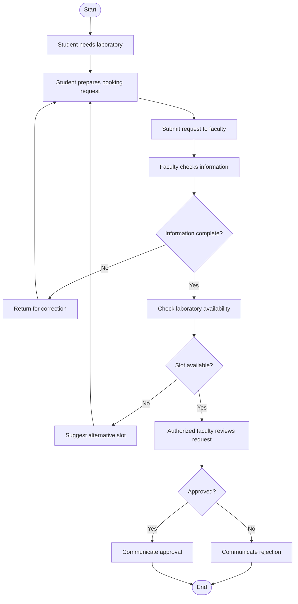

# Current Laboratory Booking Workflow

## Evidence Status

This is a hypothetical manual workflow developed for
academic analysis.

No actual ICFAI laboratory booking process was observed.
All steps and roles are assumptions.

## Current Process

## Assumed Roles

| Role | Responsibility |
|---|---|
| Student | Submits booking request |
| Faculty coordinator | Checks request details |
| Laboratory coordinator | Checks laboratory availability |
| Authorized approver | Approves or rejects requests |

## Potential Problems

1. Missing request information may cause rework.
2. Duplicate requests may increase processing effort.
3. Availability checks may require manual coordination.
4. Students may need to ask for status updates.
5. Approval records may be difficult to consolidate.

These are hypothetical risks, not verified ICFAI problems.