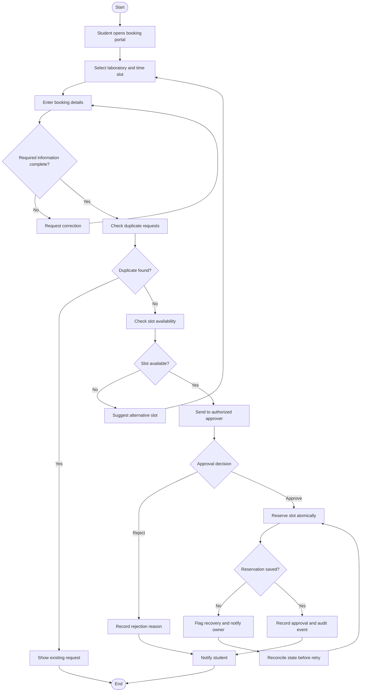

# Proposed Digital Laboratory Booking Workflow

## Proposed Solution

A centralized laboratory booking system that validates
requests and routes them to an authorized human approver.

## Required Inputs

- Synthetic requester reference
- Laboratory identifier
- Booking date
- Start time
- End time
- Purpose of booking

## Request Statuses

- DRAFT
- NEEDS_CORRECTION
- PENDING_APPROVAL
- APPROVED
- REJECTED
- CONFLICT
- RECOVERY_REQUIRED
- CANCELLED

## Approval Control

Only a designated authorized approver may approve or
reject a request.

The system must verify the approver's permissions
before accepting a decision.

## Audit Record

Each important event records:

- Request reference
- Event timestamp
- Previous status
- New status
- Action type
- Actor role
- Decision reason, when applicable

## Failure Recovery

If reservation storage fails, the request enters
RECOVERY_REQUIRED.

The accountable laboratory coordinator checks whether
a reservation was already saved before authorizing
a retry.

The system must prevent duplicate reservations.

## Technology Choice

Ordinary software rules are sufficient for:

- Required-field validation
- Duplicate detection
- Slot conflict checking
- Role-based approval
- Audit logging

Artificial intelligence is not required for the core
booking and approval process.

An AI assistant could optionally explain booking rules,
but it must not make approval decisions.